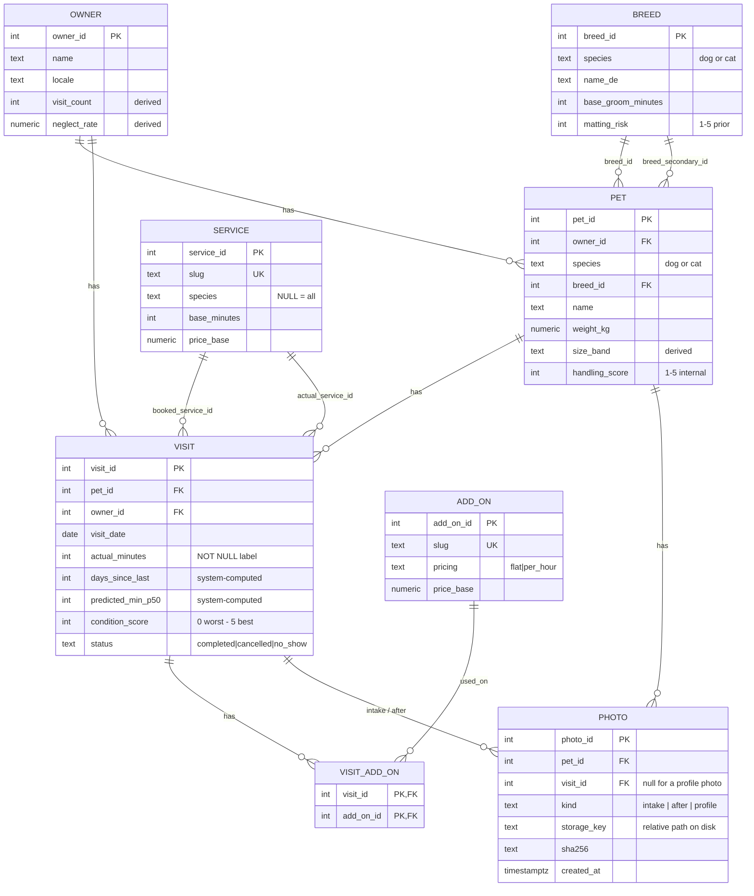

# Data model

Canonical schema for MuttMetrics. SQLAlchemy models live in `src/muttmetrics/models/`; Alembic migrations (#8 onward) materialize it in Postgres.

**Design split:** [ADR-001](./adr/001-derived-fields.md) — hand-entered vs derived vs system-computed-at-write columns.

## Entity relationships

**Navigation path:** `owner.pets` → `pet.visits` (and `owner.visits` for direct owner-level queries). Species on `pet` / `breed` / optional `service`: [ADR-004](./adr/004-species.md).

## Tables

| Table | Role | Key relationships |
|-------|------|-------------------|
| `owner` | Slow-changing client (human). Behavioural aggregates. | → many `pet`, many `visit` |
| `pet` | Slow-changing physical + temperament priors per animal (`species` dog/cat). | → `owner`, → `breed` (×2 for mixes), → many `visit` |
| `visit` | **Fact table** — one row per groom; training labels live here. | → `pet`, `owner`, → `service` (booked + actual), → many `visit_add_on` |
| `breed` | Reference priors for cold start (coat, duration, matting risk). `species` must match the pet. | ← `pet.breed_id`, `pet.breed_secondary_id` |
| `service` | Reference groom types (slug, minutes, **price floor**). | ← `visit.booked_service_id`, `visit.actual_service_id` |
| `add_on` | Technique / add-on catalog (hand stripping, etc.) ([#192](https://github.com/BOYSABIO/muttmetrics/issues/192)). | ← `visit_add_on` |
| `visit_add_on` | Which techniques were used on a visit. | → `visit`, → `add_on` |
| `photo` | One row per stored image file. Bytes live on disk under `PHOTO_ROOT`, **not** in the database ([ADR-002](./adr/002-photo-storage.md)). | → `pet` (required), → `visit` (optional — a profile photo has no visit) |

## Column groups (by table)

### `owner`

| Group | Columns |
|-------|---------|
| Hand-entered | `name`, `phone`, `email`, `locale`, `address_area`, `preferred_channel`, `client_since`, `notes` |
| Derived: computed on read ([#171](https://github.com/BOYSABIO/muttmetrics/issues/171)) | `visit_count`. The column exists, but product code counts `visit` rows instead |
| Derived: no writer yet (stay `NULL`) | `avg_rebook_days`, `neglect_rate`, `cancellation_rate`, `no_show_count`, `avg_tip_pct`, `lifetime_value`, `reliability_score` |

### `pet`

| Group | Columns |
|-------|---------|
| Identity | `owner_id`, `name`, `species` (`dog`/`cat`, [ADR-004](./adr/004-species.md)), `breed_id`, `breed_secondary_id`, `sex`, `date_of_birth`, `weight_kg` |
| Coat | `coat_type`, `hair_or_fur`, `coat_density`, `undercoat`, `sheds` |
| Temperament (internal) | `handling_score`, `fear_triggers[]`, `muzzle_required`, `two_person_job`, `temperament_notes` |
| Medical | `skin_conditions[]`, `senior_flag`, `mobility_notes`, `vet_notes` |
| Derived: computed on read ([#171](https://github.com/BOYSABIO/muttmetrics/issues/171)) | `visit_count`, `last_visit_date`. The columns exist, but product code reads `visit` rows instead |
| Derived: written through on PATCH ([#171](https://github.com/BOYSABIO/muttmetrics/issues/171) / [#190](https://github.com/BOYSABIO/muttmetrics/issues/190)) | `size_band`, from `weight_kg` + `species` via `size_band_from_weight`; `ops/backfill_size_band.py` for SQL edits |
| Derived: no writer yet (stay `NULL`) | `avg_duration_min`, `duration_stddev_min`, `typical_interval_days`, `next_due_date` |

### `visit`

| Group | Columns |
|-------|---------|
| Identity | `pet_id`, `owner_id`, `visit_date` |
| Booking | `booked_service_id`, `booking_channel`, `is_emergency`, `quoted_price` |
| System-computed at write | `days_since_last`, `predicted_min_p50`, `predicted_min_p90` |
| Intake | `condition_score` (**0 = worst … 5 = best**, or NULL), `matting_locations[]`, `fleas_or_parasites`, `arrived_wet_dirty` |
| Outcome | `actual_service_id`, `pivoted`, `pivot_reason`, `shaved_down`, `actual_minutes`, `final_price`, `tip` |
| Techniques | via `visit_add_on` → `add_on` ([#192](https://github.com/BOYSABIO/muttmetrics/issues/192); unused `add_ons[]` dropped) |
| Qualitative | `what_surprised_me`, `behaviour_this_visit` |
| Status | `status`, `cancelled_hours_before` |

### `breed` / `service`

Reference tables only — no FKs to other entities. See model files for full column lists.

### `photo`

| Group | Columns |
|-------|---------|
| Identity | `photo_id` |
| Belongs to | `pet_id` (NOT NULL), `visit_id` (nullable), `kind` (`intake` / `after` / `profile`) |
| Where the bytes are | `storage_key` (relative, unique), `storage_backend` (default `local`) |
| What the bytes are | `content_type`, `byte_size`, `sha256` |
| When | `created_at` (timestamptz, needed for retention and the orphan sweep) |

Constraints: `kind` is checked; a `profile` photo must have no `visit_id` while `intake` / `after` must have one; `byte_size > 0`. Foreign keys deliberately have **no `ON DELETE CASCADE`** — Postgres cannot delete files, so a cascade would strand bytes on disk. Deletion goes through `ops/photo_purge.py` (see [`photos.md`](../runbooks/photos.md)).

**History:** `visit.intake_photos` / `after_photos` (`TEXT[]` of URLs) were removed in [#98](https://github.com/BOYSABIO/muttmetrics/issues/98) once the SPA wrote only to this table.

## Read models (metrics)

Metrics are **SQL functions** (plus one constants view), not tables ([ADR-003](./adr/003-metric-views.md), [#170](https://github.com/BOYSABIO/muttmetrics/issues/170)). Each takes an inclusive date range, so the same definition serves a week, a month or any custom range. Definitions are in [`analytics.md`](../runbooks/analytics.md).

| Object | Kind | Returns |
|--------|------|---------|
| `metric_constants` | one-row view | `min_n`, the small-sample threshold (5) |
| `metric_summary(p_start, p_end)` | function | visit count, minutes, revenue, overall €/hour |
| `metric_eur_per_hour(p_start, p_end)` | function | €/hour by `condition_score` × `shaved_down` |
| `metric_pivot_rate` / `metric_overrun` / `metric_p90_miss` `(p_start, p_end)` | functions | timing checks against the stored prediction |
| `metric_utilization(buffer_minutes, p_start, p_end)` | function | one row per day: planned vs actual vs buffer |
| `metric_utilization_weeks(buffer_minutes, p_start, p_end)` | function | the per-day rows grouped by ISO week ([#178](https://github.com/BOYSABIO/muttmetrics/issues/178)) |

## Implementation notes

- **Arrays:** list fields use Postgres `ARRAY(Text)`, not JSON (`fear_triggers`, `matting_locations`, etc.). Techniques use `visit_add_on`, not an array on `visit`.
- **CHECK constraints** (initial migration #8, species in [#190](https://github.com/BOYSABIO/muttmetrics/issues/190)): `pet.handling_score` 1–5; `pet.species` / `breed.species` ∈ `dog`, `cat`; `service.species` NULL or those values; `visit.condition_score` 0–5; `visit.behaviour_this_visit` 1–5; `visit.status` ∈ `completed`, `cancelled`, `no_show`. Postgres rejects invalid values even if application code bugs — e.g. `condition_score = 99` fails with `ck_visit_condition_score`.
- **Scales (locked [#123](https://github.com/BOYSABIO/muttmetrics/issues/123)):** `visit.condition_score` — **0 = worst** coat / hardest job, **5 = best** / easiest, NULL = not assessed. `pet.handling_score` — **1 = easy** on the table, **5 = hardest**, NULL = unknown (rules prior treats **3** as neutral).
- **Query indexes** (migration `bba4e6f67c96`, issue #9; renamed in #190): FK columns on `pet` and `visit`, plus `visit.visit_date` — for owner/pet listings, visit history, day packing, and service-mix queries.
- **Required columns:** `owner.name`, `pet.name`, `pet.species`, `visit.visit_date`, `visit.actual_minutes`.
- **Service prices:** `service.price_base` is an optional catalog **floor**. Committed seed leaves it NULL; a gitignored `data/private/pricing.json` overlay fills it locally. Size bands live on `pet` (species-aware); on-the-spot charge on `visit.quoted_price` / `final_price` / `tip`.
- **Migrations:** Alembic — `alembic upgrade head` applies schema. See [`CONTRIBUTING.md`](../../CONTRIBUTING.md).
- **Seed:** `python -m muttmetrics.seed` upserts breeds + services + add-ons (idempotent).

### Indexes (issue #9)

| Index | Table | Column | Query path |
|-------|-------|--------|------------|
| `ix_pet_owner_id` | pet | `owner_id` | List pets per owner |
| `ix_pet_breed_id` | pet | `breed_id` | Breed analytics |
| `ix_pet_breed_secondary_id` | pet | `breed_secondary_id` | Mix breeds |
| `ix_visit_pet_id` | visit | `pet_id` | Pet visit history; recompute pet stats |
| `ix_visit_owner_id` | visit | `owner_id` | Owner visit history; recompute owner stats |
| `ix_visit_visit_date` | visit | `visit_date` | Day view, date-range filters |
| `ix_visit_booked_service_id` | visit | `booked_service_id` | Booked service mix |
| `ix_visit_actual_service_id` | visit | `actual_service_id` | Actual outcome / pivot analysis |

## Source

| Model | File |
|-------|------|
| `AddOn` | `src/muttmetrics/models/add_on.py` |
| `VisitAddOn` | `src/muttmetrics/models/visit_add_on.py` |
| `Owner` | `src/muttmetrics/models/owner.py` |
| `Pet` | `src/muttmetrics/models/pet.py` |
| `Visit` | `src/muttmetrics/models/visit.py` |
| `Breed` | `src/muttmetrics/models/breed.py` |
| `Service` | `src/muttmetrics/models/service.py` |
